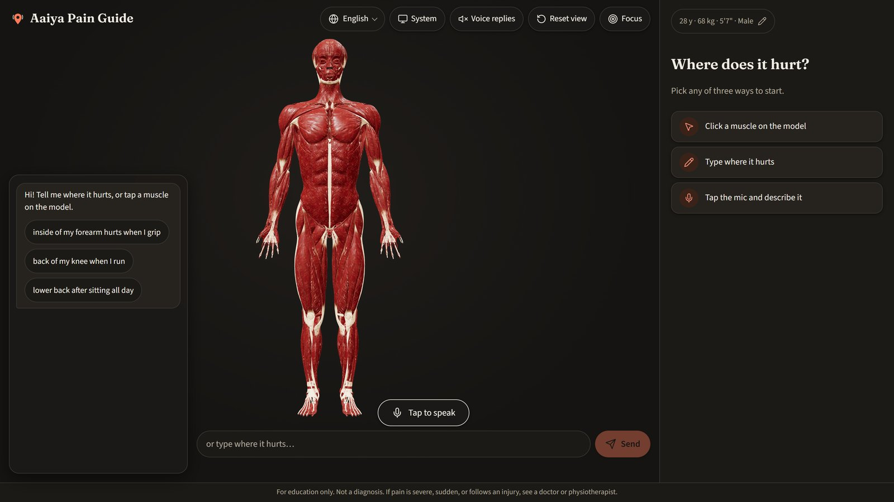
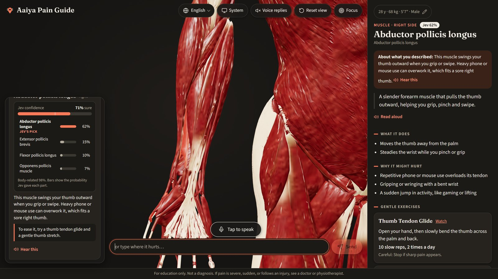
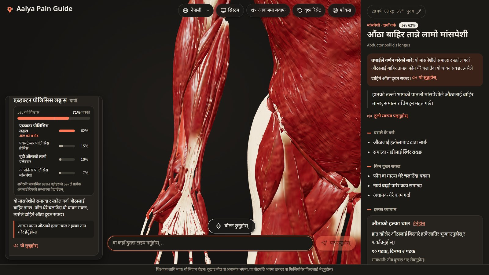
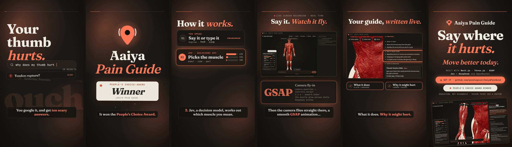

# Aaiya Pain Guide

Say (or type) where it hurts, in English, Nepali or Japanese. **Jev** works out which muscle you mean, **DeepSeek** writes a short guide for it (what it does, why it might hurt, two gentle exercises, warning signs), and the app can read the answer back to you. Whole-body 3D anatomy you can also click. Education, not diagnosis.

People's Choice Award winner.

<p align="center">
  
</p>

<p align="center"><i>GIF preview. The full video has narration, music and the app's own voice.</i></p>

## Watch the promo video

- **Download the video (MP4, 1080x1920, about 2 min):** [aaiya-pain-guide-9x16.mp4](https://github.com/pinological/AaiyaPainGuid/raw/master/hyperframe/renders/aaiya-pain-guide-9x16.mp4)
- Play it on GitHub: [hyperframe/renders/aaiya-pain-guide-9x16.mp4](hyperframe/renders/aaiya-pain-guide-9x16.mp4)
- **Download the whole project:** green **Code** button, then **Download ZIP**, or open
  <https://github.com/pinological/AaiyaPainGuid/archive/refs/heads/master.zip>

## Screenshots

| Ask | Answer | In Nepali |
| --- | --- | --- |
|  |  |  |

The promo video, frame by frame:



## How it works

1. You speak or type: "my right thumb is hurting".
2. **Jev** (`typesafe/jev-1.13`, OpenRouter Decisions API) answers three questions in one call: is this about your body, which side, which muscle (out of 250 candidate parts).
3. The camera flies to the muscle (GSAP) on the 3D model.
4. **DeepSeek** (`deepseek/deepseek-v4-flash`, OpenRouter) writes the card from the muscle name and your profile (age, weight, height). It does not browse the web.
5. **ElevenLabs** can read the answer aloud (English, Nepali, Japanese). Without a key the app falls back to the browser voice.

## Run it on your own machine

You need **Node.js 20.12 or newer** and two API keys (the voice key is optional).

```bash
git clone https://github.com/pinological/AaiyaPainGuid.git
cd AaiyaPainGuid
npm install                       # also copies the Draco decoder to public/draco
copy .env.local.example .env.local   # macOS / Linux: cp .env.local.example .env.local
```

Open `.env.local` in an editor and put in your own keys:

| Variable | What it is | Where to get it |
| --- | --- | --- |
| `OPENROUTER_API_KEY` | **Required.** Used for Jev (finding the muscle) and DeepSeek (writing the card). | <https://openrouter.ai/keys> |
| `ELEVENLABS_API_KEY` | Optional. Voice replies. The key needs the *text to speech* permission. | <https://elevenlabs.io> |
| `ELEVENLABS_VOICE_ID` | Optional. Which ElevenLabs voice to use. | ElevenLabs voice library |
| `ELEVENLABS_MODEL` | Optional. English / Japanese voice model (default `eleven_flash_v2_5`). | |
| `ELEVENLABS_MODEL_NE` | Optional. Nepali voice model (default `eleven_v3`). | |
| `DEEPSEEK_MODEL`, `JEV_MODEL` | Optional. Override the model slugs. | <https://openrouter.ai/models> |
| `JEV_CONFIDENCE_THRESHOLD` | Optional. Below this Jev confidence the "Did you mean..." picker shows. | |

Then build the part index and start the app:

```bash
npm run index    # builds data/parts.generated.json from the model's node names (first run)
npm run dev      # open http://localhost:3001
```

**Changing a key later:** edit `.env.local`, stop the server (`Ctrl+C`) and run `npm run dev` again. Keys are only read on the server and are never sent to the browser. `.env.local` is git-ignored, so never commit it.

Handy extras:

```bash
npm run warm      # pre-generate every card (resumable, saves time and credits during a demo)
npm run phrases   # check voice accuracy (aim for 16/20)
npm run typecheck
```

Open <http://localhost:3001/debug> first if the muscle names look wrong.

### Troubleshooting

- **"Could not work out the body part right now"** or a 401 in the terminal (`API key expired`): your OpenRouter key is missing, wrong or expired. Create a new one and update `OPENROUTER_API_KEY`.
- **No voice, or the robotic browser voice**: `ELEVENLABS_API_KEY` is missing, out of credits, or lacks the text-to-speech permission.
- **Microphone does not work**: browsers only allow the mic on `localhost` or HTTPS. Typing always works.
- **Try it on your phone** (same Wi-Fi): `npx next dev -p 3001 -H 0.0.0.0`, then open `http://<your PC's IP>:3001`. Typing works; the mic needs HTTPS.

## The promo video (`hyperframe/`)

The video is a [HyperFrames](https://hyperframes.heygen.com) project: HTML scenes animated with GSAP, rendered to MP4. It uses real screen recordings of this app, ElevenLabs narration, and the app's own Nepali voice.

```bash
cd hyperframe
npm run dev       # live preview and editor
npm run check     # lint, layout and contrast checks
npm run render    # writes renders/*.mp4
```

Rebuilding the media (optional, needs your keys and the app running on :3001):

```bash
cd hyperframe/capture-tools
npm install
node gen-el.mjs                          # narration + the app's voice clips (ElevenLabs, spends credits)
node rec.mjs en rec-en && node rec.mjs ne rec-ne   # real-time screen recordings of the site
```

The Jev and DeepSeek answers in the recordings are mocked in the app's own response format (`capture-tools/mock.mjs`), so the video can be rebuilt without an OpenRouter key. Local preview page for the finished MP4: `node hyperframe/renders/serve.mjs`.

## Notes

- Identity is the raw Blender node name (`userData.name`), never `object.name`. `Muscle.glb` stores spaces as `_`; `parsePart` undoes that for display.
- Left/right share one cached card per part (keyed by the side-less name).
- Jev response shape: <https://openrouter.ai/docs/guides/community/jev-tutorial>.
- Model: `public/model/body.glb` (copied from `assets/Muscle.glb`). Scripts: `index`, `warm`, `regions` (fallback, then `USE_REGIONS=1`), `phrases`, `typecheck`.
- Built from `mirror-anatomy-spec.md`.
